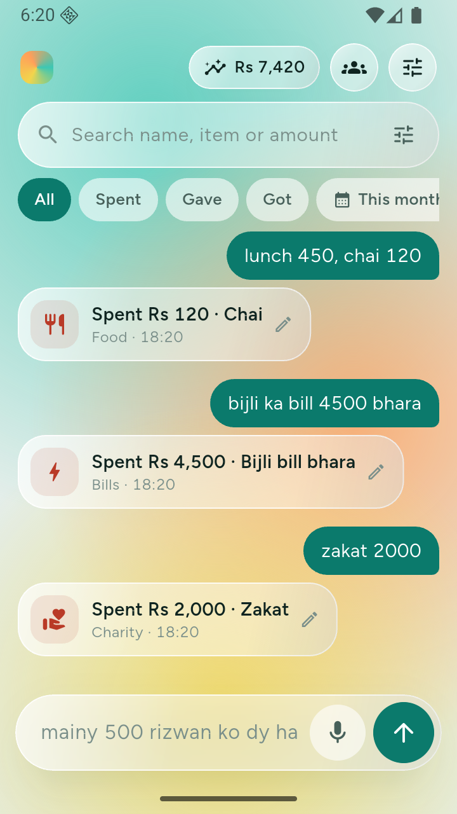
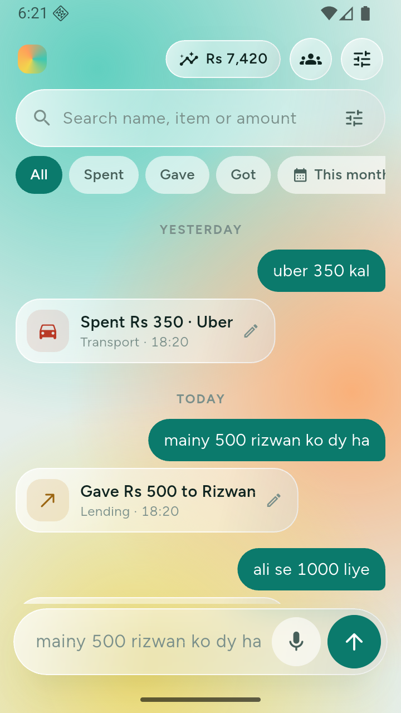
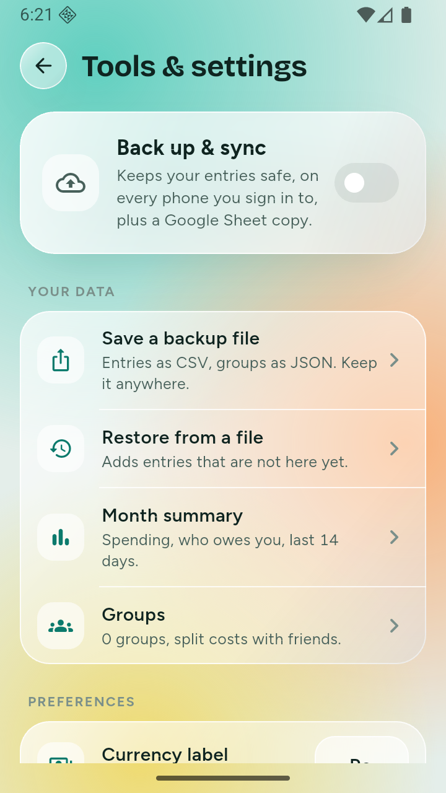
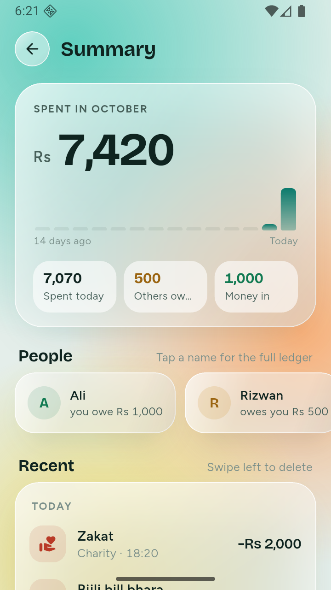
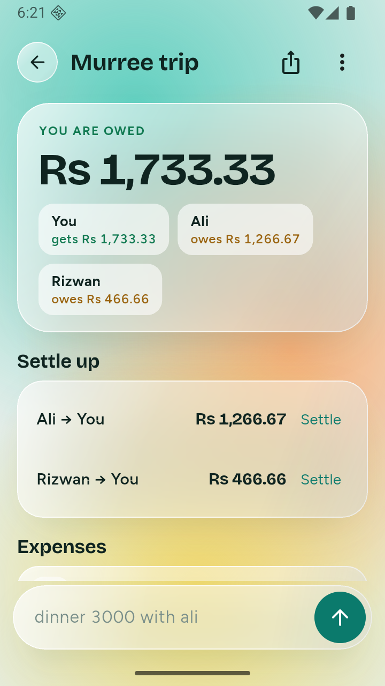

# Spendline

Chat-style expense tracker for Android, built with Flutter. Type or say what happened and it is filed:

- `lunch 500, chai 120` becomes two entries
- `mainy 500 rizwan ko dy ha` becomes "Gave Rs 500 to Rizwan"
- `ali se 1000 liye` becomes "Got Rs 1,000 from Ali"

English and Roman Urdu, offline-first, groups with split balances, optional Firebase sync and a Google Sheet backup.

| Chat | Roman Urdu | Tools |
|---|---|---|
|  |  |  |

| Summary | Group split |
|---|---|
|  |  |

## Features

- Rule-based parser for English and Roman Urdu: dates (`kal`, `3 din pehle`, `5 oct`), amounts (`2k`, `paanch sau`, `1,00,000`), debts (`milne hain`, `dene hain`)
- Per-person ledger with WhatsApp reminder
- Splitwise-style groups: equal or exact splits, simplified "who pays whom"
- Search and filters; voice input; CSV/JSON backup and restore
- Optional Backup & sync: Google sign-in, Firebase Firestore, plus a Google Sheet copy

## Run

```
flutter pub get
flutter test
flutter run
```

Release signing reads `android/key.properties` (never committed). Without it the release build falls back to the debug key.

## More

- Privacy policy: https://abdullah-ajmal147.github.io/spendline/
- Contributor notes: [CLAUDE.md](CLAUDE.md) · Play Store notes: [PLAY_STORE.md](PLAY_STORE.md) · Cloud setup: [SETUP_GOOGLE.md](SETUP_GOOGLE.md)
- Store graphics: [store/](store/)
